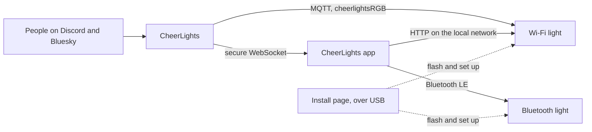
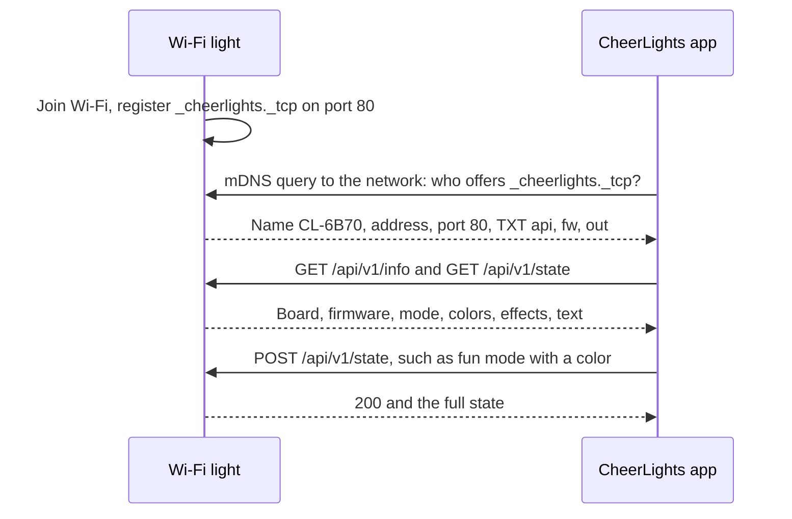
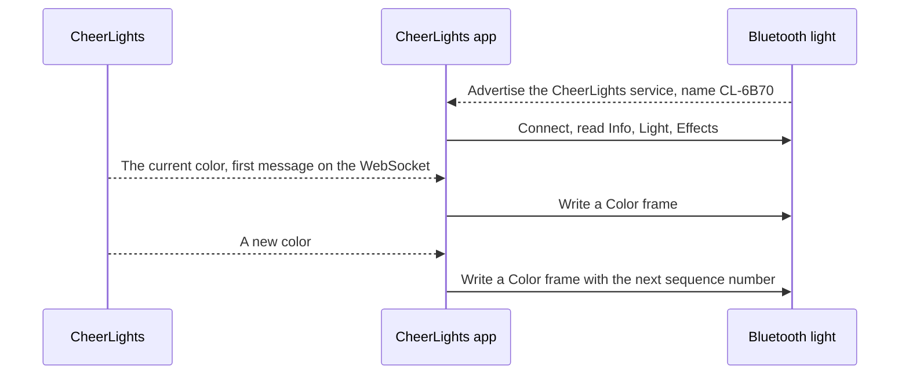

# How it fits together

This page shows the pieces around a light that runs this firmware: where the color comes from, how it reaches the light, and how the CheerLights app finds and controls a light.
The details of each interface are in [Wi-Fi lights](wifi.md) and the [CheerLights BLE profile](ble-profile.md).

## The pieces

| Piece | What it does |
|---|---|
| CheerLights | Takes color requests from the Discord `/cheerlights` command and from Bluesky, and publishes the current color. |
| Wi-Fi light | Gets the color itself over MQTT and needs no phone. Serves a small HTTP API and a page on the local network. |
| Bluetooth light | Has no network connection. Shows the color a phone writes to it. |
| CheerLights app | Shows the color, finds lights, passes the color to Bluetooth lights, and changes what any light shows. |
| [Install page](https://cheerlights.github.io/cheerlights-esp32/) | Flashes the firmware and sets the board up over USB: its wiring, Wi-Fi or Bluetooth, and its Wi-Fi networks. |

A light is a Wi-Fi light or a Bluetooth light, chosen at setup.
Both kinds follow three rules:

- Setup happens over USB only.
  Nothing over the air changes a light's wiring, its Wi-Fi networks, or its firmware.
- Over the air, a phone or a browser changes only what the light shows: on or off, the mode, the fun color, brightness, the animation, scrolling text, and a blink.
- Fun mode shows a color you pick on that one light.
  It never changes the CheerLights color everyone else sees.

## A Wi-Fi light

### Getting the color

1. The light joins the strongest saved network in range.
2. It connects to `mqtt.cheerlights.com` on port 1883 and subscribes to `cheerlightsRGB`.
3. The broker keeps the last message on that topic, so the light gets the current color as soon as it subscribes, and then every change.
4. When Wi-Fi or MQTT has been lost for 15 seconds, the light shows its last color dimmed until it reconnects.

### How the app finds it

Neither side scans for the other: the app does not probe the network for open ports, and the light does not look for the phone.
The light announces itself with mDNS (DNS-SD), the way printers and Chromecasts do, and the app asks the network which devices offer the CheerLights service.

1. When it joins Wi-Fi, the light starts an mDNS responder and registers the service `_cheerlights._tcp` on port 80.
   The service carries the light's name, such as `CL-6B70`, its host name, such as `cheerlights-6b70.local`, and three TXT records: `api`, `fw`, and `out`.
2. While Devices is open, the app browses for `_cheerlights._tcp`, and for `_wled._tcp` to list WLED lights.
   The phone sends its query to the mDNS multicast address, which every device on the same network segment receives.
3. Each light that offers the service answers with its name, address, port, and TXT records.
   On Android 14 and newer the app keeps following each light, so a new address or a light that leaves shows in the list.
4. From then on the app talks to the light over plain HTTP: `GET /api/v1/info` and `GET /api/v1/state` to read it, `POST /api/v1/state` to change it, and `POST /api/v1/identify` to make it blink.
   Each change is one request, and the app holds no connection open to a Wi-Fi light.
   While Devices is open, the app asks each light for its state again every 10 seconds, so a light that stops answering shows as unreachable before mDNS reports it gone.

mDNS is multicast, so the phone and the light have to be on the same network segment.
Guest networks, client isolation, and some mesh routers block multicast.
On those, the app finds nothing, though the light still gets and shows the color.
A browser can still open the light's page at its IP address, which `about` on the USB console shows.

## A Bluetooth light

### How the app finds it

1. The light advertises the CheerLights service UUID and its name, `CL-` and four hex digits, from a static address.
2. When you add a Bluetooth light, the app scans for advertisements that carry the service UUID, so it lists only CheerLights lights.
3. The app connects to the light you pick, as the GATT central.
   It reads `Info` to learn what the light has, then `Light`, `Effects`, and `Text` where the light has them, so its controls start from what the light shows.

### Getting the color

1. The app gets the color from CheerLights over a secure WebSocket, which sends the current color first and then each change.
2. The app writes a 10-byte frame to `Color` when it connects, on each change, and when the color's age or the stale flag changes.
   The frame holds the palette index, the RGB, a sequence number, and the minutes since the color was set.
3. When the app loses the feed, it sets the stale flag, and the light shows the color dimmed.
4. On Android, the app does this in a foreground service, so the light follows the color with the phone locked and the app closed.
5. When the phone goes out of range, the light keeps its last color and advertises again, and the app reconnects when the phone comes back.

In fun mode the app writes the color you picked as the frame instead.
In either mode, `Light` sets the brightness, the animation, and its speed.
Each Bluetooth light has its own connection, so one phone can feed several.

## WLED lights

The app also lists WLED lights it finds on the network as `_wled._tcp`, in a group of their own, with a link to each light's settings page.
A WLED light follows CheerLights through its own settings, as in [Build Your First CheerLights Light with WLED](https://cheerlights.com/first-cheerlights-light-wled/).

## Building your own

Either side of each link can be your own code:

- A script can find Wi-Fi lights with any mDNS library and control them with the [HTTP API](wifi.md#api-version-1).
- A board that implements the [BLE profile](ble-profile.md) works with the app.
  [ble-vectors.json](ble-vectors.json) has the bytes for every format, to test against.
- A light of your own can subscribe to `cheerlightsRGB` on `mqtt.cheerlights.com`, the same way this firmware does.
